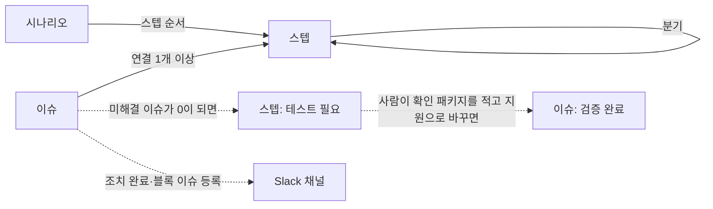

# Blockstep 설계안

- 판: 1 (2026-10-29)
- 작성: khhwang
- 청중: 플랫폼팀·엔진팀 개발자. `[확정]` 항목의 확인과 `[결정 필요]` 항목의 답을 요청한다. 답은 팀 데모 자리에서 받고, 데모에서 이의가 없는 `[확정]` 항목은 확정으로 본다
- 표기: `[확정]`은 2026-10-29 khhwang이 설계 대화에서 정한 것, `[결정 필요]`는 이 문서로 정할 것, `[데모 후 결정]`은 팀에 데모를 공유한 뒤 정할 것, `[추후]`는 첫 판에 넣지 않는 것

도구 이름은 Blockstep이다. 「막힌 스텝」이라는 뜻으로, 첫 요구사항(어디서 막혔고 왜 막혔는지)을 이름에 담았다. 2026-10-29 khhwang이 정했다 `[확정]`.

## 1. 현재 동작과 문제

lct의 개발·테스트 현황은 플랫폼팀과 엔진팀이 각자 Jira 이슈, Notion 페이지, Slack 대화에 남긴다. 어느 한 곳에도 다음 정보가 모여 있지 않다.

- 현재 패키지(Jenkins가 만드는 lct와 엔진의 묶음)에서 어느 사용자 시나리오가 끝까지 동작하고, 어느 지점에서 막히는지
- 막힌 지점의 원인 이슈가 무엇이고, 누가 언제까지 처리하는지
- 이슈가 처리된 뒤 어느 패키지부터 적용되고, 무엇을 다시 테스트해야 하는지

그래서 한 팀이 발견한 문제를 다른 팀이 모르거나, 처리된 문제를 다시 테스트하지 않거나, 같은 문제를 두 번 보고하는 일이 생긴다.

## 2. 요구사항

2026-10-29 khhwang이 적은 요구사항 여섯 가지다. 3절 이후에서 번호로 가리킨다.

| 번호 | 요구사항 |
|---|---|
| 1 | 시나리오마다 어디까지 지원되고 어느 분기에서 막혔는지, 막힌 뒤의 흐름이 무엇인지 한 화면에서 보인다 |
| 2 | 시나리오를 스텝 단위로 쓰고, 기존 시나리오의 특정 스텝에서 분기를 만들어 상태를 적을 수 있다 |
| 3 | 스텝마다 이슈를 등록하고 개수를 보며, 이슈 화면으로 이동할 수 있다. 정상 스텝과 블록 스텝 모두 가능하다 |
| 4 | 이슈에 시나리오·스텝, 설명, 리포터, 담당자, 처리 상황, 처리 상태, 처리 후 내용, 목표 기한, 중요도를 적는다 |
| 5 | 블록 스텝의 이슈가 모두 해결되면 스텝이 테스트 필요 상태로 바뀐다 |
| 6 | 이슈가 조치 완료로 바뀌면 그 내용을 알린다 |

## 3. 전제

| 전제 | 내용 | 정한 때 |
|---|---|---|
| 별도 웹앱으로 만든다 | Jira는 스텝과 분기 구조가 없고, Notion은 분기 흐름을 상태 색으로 그리지 못한다. 기존 테스트 관리 도구(TestRail, Qase, Kiwi TCMS, TestLink, Xray)는 모두 케이스 아래에 스텝을 한 줄로 나열하는 구조라 분기를 표현하지 못한다 | 2026-10-29 `[확정]` |
| 시나리오 집합은 하나 | 제품은 lct 하나이고, 패키지는 매일 바뀐다. 패키지마다 시나리오나 스텝 상태를 따로 두지 않고, 패키지는 스텝과 이슈에 적는 값으로만 쓴다 | 2026-10-29 `[확정]` |
| 분기는 트리 | 스텝에서 분기가 나뉘기만 하고 다시 합쳐지지 않는다 | 2026-10-29 `[확정]` |
| 이슈는 도구 안에 둔다 | Jira가 정본이 아니다. `Jira 키` 칸만 선택으로 둔다 | 2026-10-29 `[확정]` |
| 로그인 없음 | 사내망에 두고, 리포터·담당자·확인자는 도구에 등록한 사람 목록에서 고른다 | 2026-10-29 `[확정]` |
| 별도 저장소 | lct 저장소가 아니라 `github.com/hwangkyungha/blockstep`에 둔다. lct의 빌드·테스트·E2E 게이트와 무관하고, 엔진팀도 함께 고치는 코드다 | 2026-10-29 `[확정]` |

## 4. 전체 그림

도구는 세 가지 자료를 다룬다.

- 시나리오: 사용자 여정 하나(예: 설치부터 테스트 실행까지)를 스텝의 순서로 적은 것
- 스텝: 시나리오의 한 단계. 상태 하나와 마지막 확인 기록을 갖고, 분기를 가질 수 있다
- 이슈: 어느 스텝에서 발견한 문제. 처리 상태, 담당자, 발견 패키지, 반영 패키지를 갖는다

패키지를 적는 칸은 셋이다. 스텝의 `확인 패키지`는 그 스텝의 동작을 마지막으로 확인한 패키지다. 이슈의 `발견 패키지`는 문제를 처음 본 패키지이고, `반영 패키지`는 수정이 처음 들어간 패키지다.

미해결 이슈는 처리 상태가 `조치 완료`, `검증 완료`, `거절` 가운데 하나가 아닌 이슈다.

세 자료의 관계와 자동 전환은 아래와 같다.



화면은 넷이다. 시나리오 목록, 시나리오 노선도(편집 탭 포함), 이슈 목록, 이슈 상세다. UI 초안은 Design 캔버스 「Blockstep UI 초안」에 있고, 링크는 README에 적는다.

## 5. 영역별 계획

### 5.1 시나리오와 스텝

#### 하는 일

시나리오는 사용자 여정 단위로 새로 쓴다. 저장소의 확정 spec Scenario(`<capability>-SCN-NN`)와 E2E TC ID는 스텝의 `참조` 칸에 적는다. 2026-10-29 `[확정]`.

- 근거: spec Scenario는 capability 하나 안의 동작만 다루므로 엔진, lct, 스킬에 걸친 흐름을 보여 주지 못한다. 참조 칸이 있으면 나중에 두 체계를 연결할 수 있다

스텝의 상태는 다섯 가지다. 2026-10-29 `[확정]`.

| 상태 | 색 | 뜻 |
|---|---|---|
| 지원 | 녹색 | 확인 패키지에서 동작을 확인했다 |
| 블록 | 빨강 | 이슈 때문에 진행하지 못한다. 미해결 이슈가 하나 이상 연결되어야 설정할 수 있다 |
| 테스트 필요 | 노랑 | 연결된 이슈가 모두 해결되었거나, 사람이 다시 확인하기로 표시했다 |
| 미구현 | 회색 | 계획만 있고 아직 만들지 않았다 |
| 미확인 | 흰색 | 아직 아무도 확인하지 않았다 |

상류 차단은 저장하는 상태가 아니라 화면을 그릴 때 계산하는 표시다. 상위 스텝 가운데 `블록`이 있으면 그 아래 스텝은 자기 상태 색을 연하게 하고 빗금을 덧그린다. 상위 블록이 풀리면 원래 색으로 돌아간다. 2026-10-29 `[확정]`.

- 근거: 하위 스텝의 상태를 `미확인`으로 바꾸는 방식과 비교했다. 그 방식은 하위 스텝이 원래 `지원`이었다는 기록을 지우므로, 상위 블록이 풀린 뒤 하위 스텝을 전부 다시 확인해야 한다

스텝마다 `확인 패키지`, `확인자`, `확인일`을 둔다. 상태를 `지원`으로 바꿀 때 확인 패키지 입력은 필수다. 확인일로부터 14일이 지나면 노선도에서 스텝 이름 아래에 확인일을 굵은 강조색으로 표시하고 「N일 지남」 텍스트를 붙인다. 상태는 자동으로 바꾸지 않는다. 기간은 설정 값 `stale_days` 하나로 둔다. 2026-10-29 `[확정]`.

- 근거: 패키지별 상태를 두지 않으므로, 녹색 스텝이 어느 시점의 확인인지 알려 주는 표시가 필요하다. 색만 연하게 바꾸는 방식은 알아보기 어렵다는 khhwang의 의견(2026-10-29)에 따라 텍스트로 표시한다
- 근거: 14일이 지난 스텝을 자동으로 `테스트 필요`로 바꾸는 방식과 비교했다. 그 방식은 여러 스텝이 같은 날 한꺼번에 바뀌어 이슈 해결로 바뀐 스텝과 구분되지 않는다

패키지 식별자는 형식을 강제하지 않는 자유 텍스트다(예: `2026-10-29`, `2026-10-29 #123`). 이슈와 스텝에 적힌 값을 모아 입력 시 자동 완성으로 보여 준다. 패키지 등록 화면은 없다. 2026-10-29 `[확정]`.

#### 분기의 자료 구조

시나리오는 스텝의 순서(목록)다. 스텝은 분기를 0개 이상 가질 수 있다. 분기 하나는 조건 라벨 하나와 스텝의 순서로 이루어진다. 분기 안의 스텝도 다시 분기를 가질 수 있다.

편집은 들여쓰기 목록(아웃라인)으로 한다. 같은 깊이의 줄은 순서대로 이어지는 스텝이다. 어떤 스텝 아래에 한 단계 들여쓴 `? 조건` 줄을 두면 그 스텝에서 분기가 시작된다. `? 조건` 줄 아래에 같은 깊이로 적은 줄이 그 분기의 스텝이다.

```
1. lct install 실행
2. 에이전트 선택
3. 라이선스 확인
   ? 라이선스 없음
     3a. 평가판 라이선스 안내
     3b. 평가판 모드로 진입
4. lct config ct
5. 분석 실행
```

- 근거: 노선도 위에서 직접 편집하는 방식과 비교했다. 그 방식은 드래그와 연결선 편집 UI를 따로 만들어야 하고, 들여쓰기 목록은 Tab 키 하나로 분기를 표현한다

#### 노선도 표기

노선도는 시나리오 하나를 지하철 노선도 형태로 그린 화면이다. 요구사항 1을 맡는다.

- 본선은 가로 선 하나다. 스텝은 선 위의 둥근 표시이고, 스텝 사이 구간에 그 구간이 이르는 스텝의 상태 색을 칠한다
- 분기는 분기가 시작되는 스텝에서 아래로 내려가 가로로 이어지는 선이다. 내려가는 지점에 조건 라벨을 표시한다
- 스텝 표시의 위 오른쪽에 미해결 이슈 개수를 배지로 표시한다. 그 가운데 블록 스텝에 연결된 이슈가 있으면 빨강, 없으면 회색이다. 배지를 클릭하면 그 스텝으로 필터된 이슈 목록으로 이동한다
- 스텝 표시 아래에 스텝 이름과 확인일을 표시한다. 14일이 지난 `지원` 스텝은 확인일과 「N일 지남」을 강조한다

#### 결정 안건

- `[결정 필요]` 첫 판에 넣을 시나리오 목록. 제안: 설치, 에이전트 설정, 분석(`lctpa`, 고객 프로젝트를 분석해 모듈 정의와 TEU를 만드는 단계), 테스트 생성, 테스트 실행, 요구사항 추적의 여섯 여정
- `[결정 필요]` 시나리오와 스텝을 누가 쓰는가. 제안: 플랫폼팀이 초안을 쓰고 양 팀이 고친다

### 5.2 이슈

#### 항목

요구사항 4를 아래 칸으로 정리한다. 2026-10-29 `[확정]`.

| 항목 | 입력 | 설명 |
|---|---|---|
| 제목 | 필수 | |
| 연결 스텝 | 필수, 여러 개 | 시나리오 이름과 스텝 이름으로 표시 |
| 발견 패키지 | 필수 | 자유 텍스트, 자동 완성 |
| 설명 | 필수 | 재현 방법과 증상 |
| 리포터 | 필수 | 사람 목록에서 선택 |
| 담당자 | 선택 | 사람 목록에서 선택. 담당자를 처음 지정하면 처리 상태가 `등록`에서 `담당자 배정`으로 바뀐다 |
| 처리 상황 기록 | 덧붙임 | 담당자가 수시로 덧붙이는 기록. 작성자와 날짜는 자동 |
| 처리 상태 | 필수 | 아래 「처리 상태」의 값 가운데 하나 |
| 처리 후 내용 | `조치 완료`로 바꿀 때 필수 | 새 바이너리 적용 방법, 바뀐 API, 설정 변경 |
| 반영 패키지 | `조치 완료`로 바꿀 때 필수 | 자유 텍스트, 자동 완성 |
| 목표 기한 | 선택 | 날짜 |
| 긴급도 | 필수 | P1은 다음 패키지에 반드시 반영, P2는 이번 주 안, P3는 일정 없음 |
| 블록 여부 | 자동 | 연결 스텝 가운데 하나라도 `블록`이면 켜진다 |
| Jira 키 | 선택 | 예: `CT2612-405` |
| 등록일, 마지막 변경일 | 자동 | |

- 근거: 처리 상황을 한 칸으로 두는 방식과 비교했다. 한 칸이면 이전 내용이 덮어써져 날짜별 경과가 남지 않는다
- 근거: 요구사항 4의 「중요도(긴급도, 막혀 있는 시나리오 표시)」를 긴급도와 블록 여부로 나눈다. 블록 여부를 사람이 입력하면 스텝 상태와 어긋날 수 있으므로 자동으로 계산한다

#### 처리 상태

2026-10-29 `[확정]`.

```
등록 → 담당자 배정 → 처리 중 → 반영 대기 → 조치 완료 → 검증 완료
                      ↘ 보류 / 거절
```

- `반영 대기`: 수정이 머지되었으나 그 수정이 든 패키지가 아직 없다. 반영 패키지가 나오면 `조치 완료`로 바꾼다
- `조치 완료`: 반영 패키지와 처리 후 내용을 적은 상태. 스텝 자동 전환과 Slack 알림은 이 상태로 바뀔 때 일어난다
- `검증 완료`: 테스트에서 동작을 확인한 상태. 사람이 직접 바꾸거나 5.3의 규칙 3으로 자동으로 바뀐다
- `거절`: 고치지 않기로 한 이슈. 미해결 이슈를 셀 때 해결로 센다. 그렇지 않으면 거절된 이슈가 연결된 스텝이 `블록`에서 벗어나지 못한다

#### 목록 정렬과 필터

목록은 블록 여부, 긴급도, 목표 기한 순으로 정렬한다. 필터는 처리 상태, 담당자, 블록 여부, 시나리오, 스텝이다.

### 5.3 상태 전환과 알림

#### 자동 전환 규칙

요구사항 5를 맡는다. 2026-10-29 `[확정]`.

1. 스텝을 `블록`으로 바꾸려면 미해결 이슈가 하나 이상 연결되어 있어야 한다. 없으면 저장을 거부하고 이슈 등록 화면으로 안내한다
2. 이슈의 처리 상태가 바뀌어 어떤 `블록` 스텝의 미해결 이슈가 0이 되면, 그 스텝을 `테스트 필요`로 바꾸고 변경 이력에 「이슈 #N 조치 완료로 자동 전환」을 남긴다
3. 사람이 스텝을 `지원`으로 바꾸면, 그 스텝에 연결된 `조치 완료` 이슈 가운데 연결된 모든 스텝이 `지원`인 이슈를 `검증 완료`로 바꾸고 변경 이력을 남긴다
4. 이슈의 블록 여부는 저장하지 않고 연결 스텝의 상태로 계산한다

#### 변경 이력과 알림

모든 스텝 상태 변경, 이슈 항목 변경, 처리 상황 기록 추가는 변경 이력 테이블에 남긴다. 첫 판에서 변경 이력은 이슈 상세 화면 안에서만 보이고, 전체 변경 이력 화면은 두지 않는다.

Slack으로 보내는 사건은 둘이다. 요구사항 6을 맡는다. 2026-10-29 `[확정]`.

| 사건 | Slack 메시지 내용 |
|---|---|
| 이슈가 `조치 완료`로 바뀜 | 제목, 반영 패키지, 처리 후 내용, `테스트 필요`로 바뀐 스텝 목록 |
| `블록` 스텝에 연결된 이슈가 새로 등록됨 | 제목, 막힌 스텝, 긴급도 |

- 근거: 모든 변경을 Slack에 보내는 방식과 비교했다. 그 방식은 담당자 배정과 기록 추가까지 채널에 쌓여 조치 완료 메시지를 찾기 어렵게 한다

Slack은 Incoming Webhook URL 하나를 설정 값 `slack_webhook_url`로 받는다. 웹훅 전송이 실패해도 상태 변경은 저장하고, 전송 실패를 변경 이력에 남긴다.

#### 결정 안건

- `[데모 후 결정]` 알림을 보낼 Slack 채널. 제안: 새 채널 하나를 만든다. 결정 전까지 웹훅 URL 설정을 비워 두고, 비어 있으면 Slack 전송을 건너뛴다

### 5.4 화면과 기술

#### 화면 넷

| 화면 | 보여 주는 것 | 요구사항 |
|---|---|---|
| 시나리오 목록 | 시나리오마다 상태 비율 막대, 블록 스텝 수, 14일 지난 스텝 수. 상단에 전체 요약 | 1 |
| 시나리오 노선도 | 5.1의 노선도. `편집` 탭에 아웃라인 편집기와 스텝 상태 변경 폼 | 1, 2, 3 |
| 이슈 목록 | 5.2의 정렬과 필터. 노선도의 배지에서 들어오면 그 스텝으로 필터된 상태 | 3 |
| 이슈 상세 | 5.2의 항목 편집, 처리 상황 기록, 조치 완료 입력 폼, 변경 이력 | 4 |

요구사항 5와 6은 화면이 아니라 5.3의 규칙으로 충족한다.

#### 기술

2026-10-29 `[확정]`.

- Go `net/http`와 `html/template`로 서버에서 HTML을 만든다. 부분 갱신은 htmx로 한다
- 노선도는 서버가 SVG로 만든다
- 저장은 SQLite 파일 하나다. 변경 이력 테이블을 포함한다
- 배포는 실행 파일 하나를 사내 서버에서 실행한다. 프론트엔드 빌드 도구는 두지 않는다

- 근거: SPA(브라우저에서 화면을 만드는 방식)와 비교했다. SPA는 Node 빌드 파이프라인과 npm 의존을 따로 관리해야 한다. 서버 렌더링은 lct 저장소와 같은 Go 하나로 유지할 수 있고, SQLite 파일 하나는 파일 복사로 백업된다

#### 자료 구조

| 테이블 | 주요 칸 |
|---|---|
| scenario | id, name, description, sort_order |
| step | id, scenario_id, parent_branch_id(본선이면 비움), sort_order, name, refs, status, checked_package, checked_by, checked_at |
| branch | id, from_step_id, label, sort_order |
| issue | id, title, description, reporter, assignee, status, priority, found_package, applied_package, due_date, resolution_note, jira_key, created_at, updated_at |
| issue_step | issue_id, step_id |
| issue_note | id, issue_id, author, body, created_at |
| change_log | id, entity, entity_id, field, old_value, new_value, actor, at |
| person | name |
| setting | key, value (`stale_days`=14, `slack_webhook_url`) |

#### 작업 목록

크기는 상대 크기다. S는 하루 안, M은 며칠, L은 일주일 넘게 걸리는 작업이다.

| 하는 일 | 크기 | 선행 |
|---|---|---|
| 자료 구조와 SQLite 마이그레이션 | S | 없음 |
| 시나리오·스텝·분기 CRUD와 아웃라인 편집기(텍스트를 트리로 바꾸는 파서) | M | 자료 구조 |
| 노선도 SVG 생성(분기 배치, 상류 차단 계산, 14일 경과 표시) | M | 아웃라인 편집기 |
| 이슈 CRUD, 처리 상황 기록, 목록 정렬·필터 | M | 자료 구조 |
| 자동 전환 규칙과 변경 이력 | S | 이슈 CRUD, 스텝 CRUD |
| Slack 웹훅 | S | 자동 전환. 채널은 데모 후 설정 값으로 넣는다 |
| 첫 시나리오 여섯 개 입력 | M | 시나리오 목록 결정 |
| 사내 서버 배포 | S | 위 전부 |

## 6. 범위 커트라인

반드시 넣을 것: 5.1의 노선도와 아웃라인 편집, 5.2의 이슈 항목, 5.3의 자동 전환 규칙 넷과 Slack 알림 둘.

넣고 뺄 후보:

| 후보 | 판단 재료 | 현재 제안 |
|---|---|---|
| 전체 변경 이력 화면 | 이슈 상세 안의 이력만으로 첫 달을 지낼 수 있는지 | 뺀다. 이력 테이블은 있으므로 나중에 화면만 붙인다 |

범위 밖:

- `[추후]` Jira 양방향 동기화. Jira 키 칸으로 수동 연결만 한다. 플랫폼팀과 엔진팀의 Jira 프로젝트 둘에 5.2의 항목을 커스텀 필드로 만들고, 처리 상태를 양방향으로 맞추는 연동을 구현해야 한다
- `[추후]` 제품 칸. 다른 제품이 들어올 때 추가한다
- `[추후]` 로그인과 권한. 사내망 배치로 대신한다
- `[추후]` E2E 자동 실행 결과를 스텝 상태로 반영. 스텝의 `참조` 칸에 TC ID를 적어 두므로 나중에 연결할 수 있다
- `[추후]` 패키지별 상태 비교. 첫 판에서는 이슈의 발견 패키지와 반영 패키지로 대신한다

## 7. 수락 기준

- 시나리오 하나를 아웃라인으로 입력하면 분기가 있는 노선도가 그려지고, 상태 색과 상류 차단 표시가 5.1의 표기와 같다
- 블록 스텝에 이슈를 연결하고 그 이슈를 `조치 완료`로 바꾸면 스텝이 `테스트 필요`로 바뀌고 Slack에 메시지가 온다
- 스텝을 `지원`으로 바꿀 때 확인 패키지를 적지 않으면 저장되지 않는다. 적으면 연결된 `조치 완료` 이슈가 `검증 완료`가 된다
- 확인일이 14일 지난 `지원` 스텝은 노선도에 「N일 지남」이 표시된다
- 이슈 목록이 블록 여부, 긴급도, 목표 기한 순으로 정렬된다
- 실행 파일 하나와 SQLite 파일 하나로 사내 서버에서 실행된다

## 참고한 도구

| 도구 | 가져온 것 | 바꾼 것 |
|---|---|---|
| Xray (Jira 테스트 관리) | 수동 테스트 실행 화면에서 스텝마다 결함을 만들거나 연결하는 Defects 칸 | Xray는 BLOCKED가 기본 상태가 아니고, 스텝 하나가 BLOCKED여도 전체 결과는 FAIL로 집계된 사례가 있다. 이 도구는 `블록`과 상류 차단을 구분한다 |
| TestCompass, Yest (흐름도 기반 테스트 설계) | 결정 노드에서 분기가 나뉘는 모델 | 두 도구에는 지원 상태 개념이 없다. 이 도구는 스텝마다 상태를 둔다 |
| caniuse, MDN 호환표 | 지원과 미지원을 색으로 구분하는 표 | 표는 어느 스텝에서 막혔는지 보여 주지 못한다. 이 도구는 노선도로 그린다 |
